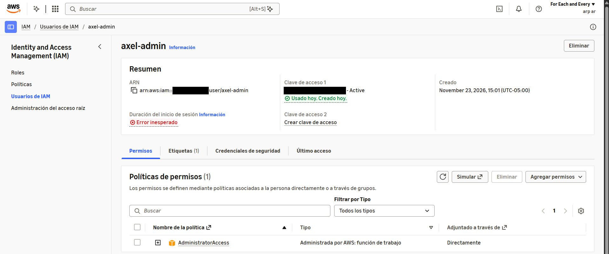
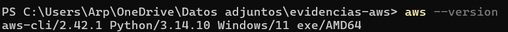
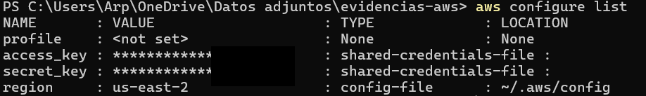
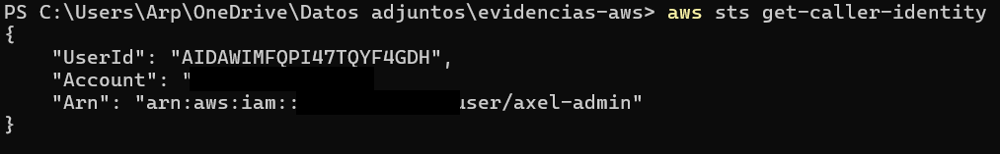
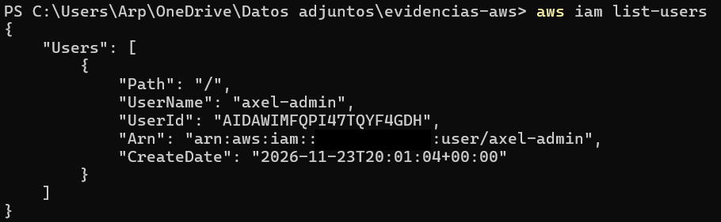
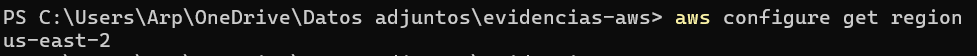

# Actividad 1: configuración inicial de AWS

Configuración de un usuario de trabajo y de la AWS CLI v2 conectada a la cuenta (guía `03-activity.md`, semana 1).

- **Usuario de trabajo:** `axel-admin`
- **Región:** `us-east-2` (Ohio)
- **Sistema:** Windows 11, con la CLI instalada mediante `winget install --id Amazon.AWSCLI`

> El número de cuenta y los identificadores de las llaves están tapados en las capturas. No se incluye ninguna clave secreta.

## 1. Usuario de trabajo con `AdministratorAccess` (consola)

El usuario `axel-admin` tiene la política `AdministratorAccess` adjuntada directamente y una clave de acceso activa.



## 2. AWS CLI v2 instalada

```powershell
aws --version
```



## 3. AWS CLI configurada

`aws configure list` muestra de dónde sale cada valor sin revelar las llaves.

```powershell
aws configure list
```



## 4. Comprobar la conexión

El `Arn` termina en `user/axel-admin`: la CLI está conectada con el usuario de trabajo y no con el usuario raíz.

```powershell
aws sts get-caller-identity
```



## 5. Comprobar los permisos

El comando responde sin `AccessDenied`, así que el usuario tiene permisos.

```powershell
aws iam list-users
```



## 6. Región configurada

La región de la CLI coincide con la de la consola.

```powershell
aws configure get region
```


