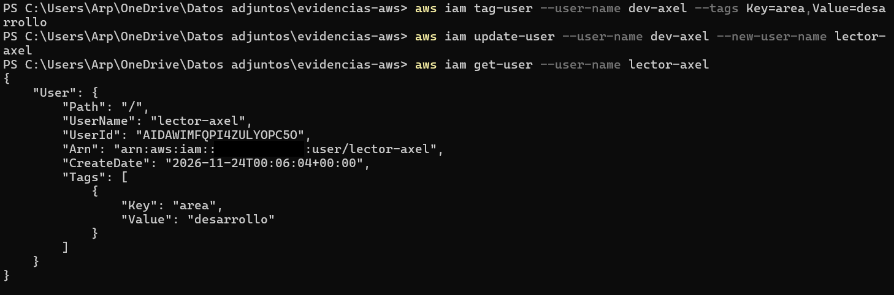
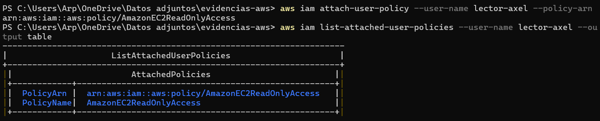
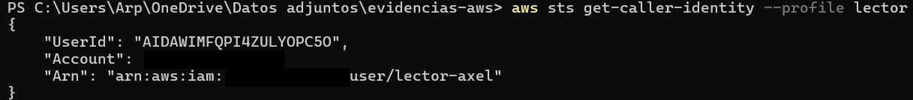
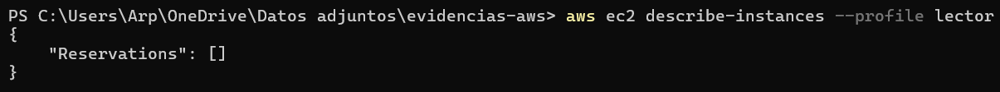
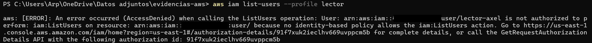
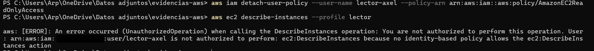
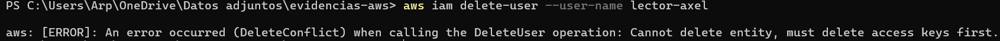
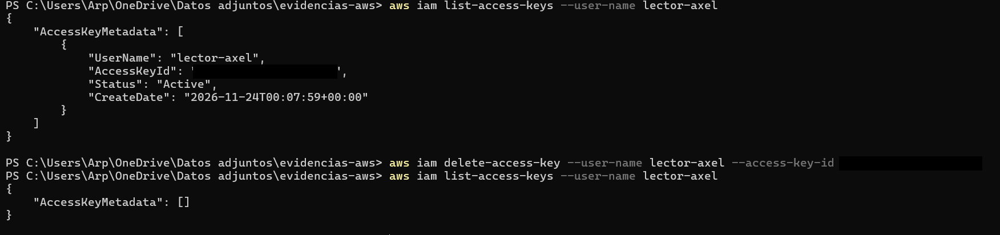
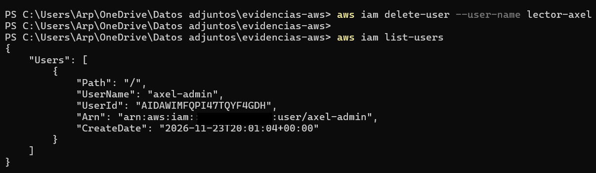

# Actividad 2: ciclo de vida de un usuario IAM

Crear, consultar, editar, probar y eliminar un usuario IAM desde la AWS CLI aplicando el principio de menor privilegio (guía `03-activity-iam.md`, semana 1).

- **Usuario administrador:** `axel-admin`
- **Usuario de práctica:** `dev-axel`, renombrado a `lector-axel`
- **Región:** `us-east-2`

> El número de cuenta y los identificadores de las llaves están tapados en las capturas. No se incluye ninguna clave secreta.

## Partes 1 y 2: crear y editar (pasos 1 a 6)

```powershell
aws iam create-user --user-name dev-axel
aws iam tag-user --user-name dev-axel --tags Key=area,Value=desarrollo
aws iam update-user --user-name dev-axel --new-user-name lector-axel
aws iam get-user --user-name lector-axel
```

No hay captura del paso 3 (`get-user` de `dev-axel` recién creado). Al renombrarlo, ese nombre dejó de existir y `get-user --user-name dev-axel` responde `NoSuchEntity`. La captura muestra `tag-user` y `update-user` ejecutados sobre `dev-axel`, lo que confirma que el usuario existía, y el resultado: el nombre nuevo, la etiqueta conservada y un `Arn` que ahora termina en `user/lector-axel`.



## Parte 3: dar permisos (pasos 7 y 8)

```powershell
aws iam attach-user-policy --user-name lector-axel --policy-arn arn:aws:iam::aws:policy/AmazonEC2ReadOnlyAccess
aws iam list-attached-user-policies --user-name lector-axel --output table
```



## Parte 4: probar el menor privilegio (pasos 9 a 13)

La llave se creó con `create-access-key` y se guardó en el perfil `lector` con `aws configure --profile lector`. Ese paso no se capturó porque muestra la clave secreta.

**Paso 11: identidad del perfil `lector`**

```powershell
aws sts get-caller-identity --profile lector
```



**Paso 12: acción permitida.** Responde sin error. La lista está vacía porque la cuenta no tiene instancias EC2.

```powershell
aws ec2 describe-instances --profile lector
```



**Paso 13: acción no permitida**

```powershell
aws iam list-users --profile lector
```



## Parte 5: quitar permisos (pasos 14 y 15)

Después de quitar la política, la acción que antes funcionaba también falla. Los cambios de IAM tardan unos segundos en propagarse, así que se esperó unos 15 segundos antes de repetir el comando.

```powershell
aws iam detach-user-policy --user-name lector-axel --policy-arn arn:aws:iam::aws:policy/AmazonEC2ReadOnlyAccess
aws ec2 describe-instances --profile lector
```



## Parte 6: eliminar (pasos 16 a 20)

**Reto: borrar el usuario con la llave todavía activa**

```powershell
aws iam delete-user --user-name lector-axel
```



**Paso 16: listar y borrar la llave de acceso**

```powershell
aws iam list-access-keys --user-name lector-axel
aws iam delete-access-key --user-name lector-axel --access-key-id <id>
aws iam list-access-keys --user-name lector-axel
```



**Pasos 17 a 19: borrar el usuario y comprobarlo.** El usuario ya no tenía políticas desde la parte 5.

```powershell
aws iam delete-user --user-name lector-axel
aws iam list-users
```



**Paso 20:** se quitaron el bloque `[lector]` de `~/.aws/credentials` y `[profile lector]` de `~/.aws/config`.

---

## Preguntas de reflexión

1. ¿Qué podía hacer el usuario justo después de crearlo, antes de adjuntarle una política? ¿Por qué?

   No podría hacer nada, debido a que aún no se le han asignado permisos.

2. En el error del paso 13, ¿qué tres datos te dice el mensaje?

   El usuario `user/lector-axel` intentó aplicar la acción `iam:ListUsers` y fue denegado debido a que sus políticas no lo permiten.

3. ¿Por qué cambió el `Arn` al renombrar el usuario?

   El ARN cambió debido a que, si cambia el nombre, cambia también el ARN. Sabemos que es el mismo usuario debido a que el `UserId` está ligado al usuario, no a su nombre.

4. ¿Por qué AWS obliga a borrar las llaves antes de borrar el usuario?

   Quedaría la llave sin dueño, al aire, y no se podría modificar.

5. ¿Qué pasaría si le hubieras dado `AdministratorAccess` en vez de solo lectura? ¿En qué caso real estaría justificado?

   Habría tenido acceso total a la cuenta, permitiéndole listar los usuarios y crear o borrar a otros, y en caso de robar la llave se tendría acceso total. Es aceptable en casos donde la persona deba administrar completamente la cuenta.
