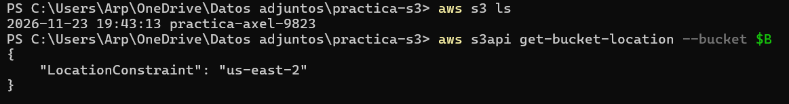
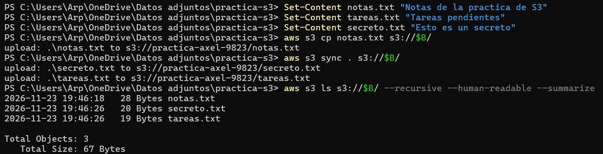
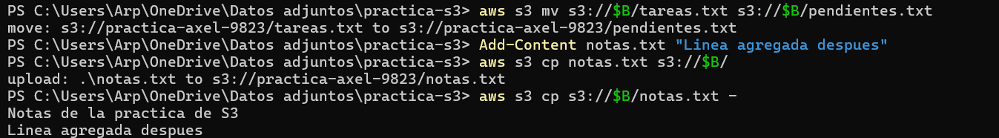
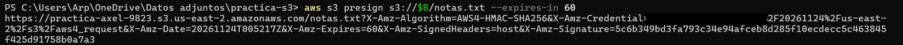
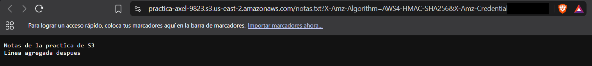
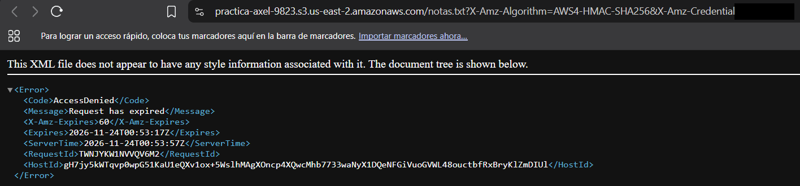
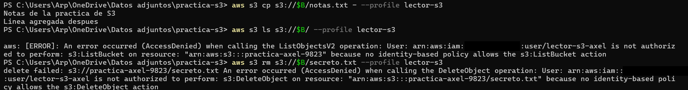
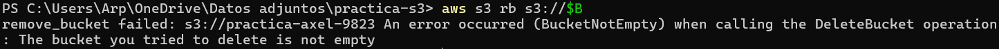
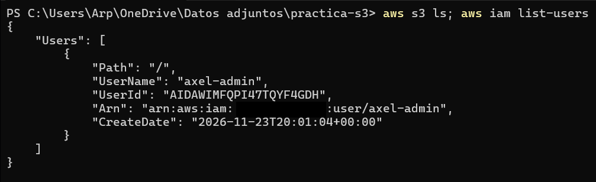

# Actividad 3: ciclo de vida de un bucket en S3

Crear un bucket; subir, consultar, modificar y compartir objetos desde la AWS CLI, y protegerlo con una política de menor privilegio (guía `03-activity-bucket.md`, semana 1).

- **Usuario administrador:** `axel-admin`
- **Bucket:** `practica-axel-9823`, guardado en la variable de PowerShell `$B`
- **Usuario de solo lectura:** `lector-s3-axel`, con el perfil `lector-s3`
- **Región:** `us-east-2`

> El número de cuenta y los identificadores de las llaves están tapados en las capturas. No se incluye ninguna clave secreta.

## Parte 1: crear (pasos 1 a 3)

```powershell
$B = "practica-axel-9823"
aws s3 mb s3://$B
aws s3 ls
aws s3api get-bucket-location --bucket $B
```

El bucket existe y está en la región del proyecto.



## Parte 2: subir (pasos 4 a 7)

`sync` solo subió `secreto.txt` y `tareas.txt`, porque `notas.txt` ya estaba en el bucket.

```powershell
aws s3 cp notas.txt s3://$B/
aws s3 sync . s3://$B/
aws s3 ls s3://$B/ --recursive --human-readable --summarize
```



## Parte 4: editar (pasos 11 a 13)

`tareas.txt` se renombró a `pendientes.txt` y `notas.txt` se sobrescribió con una línea nueva. S3 no guarda la versión anterior.

```powershell
aws s3 mv s3://$B/tareas.txt s3://$B/pendientes.txt
Add-Content notas.txt "Linea agregada despues"
aws s3 cp notas.txt s3://$B/
aws s3 cp s3://$B/notas.txt -
```



## Parte 5: compartir sin hacerlo público (pasos 14 a 16)

```powershell
aws s3 presign s3://$B/notas.txt --expires-in 60
```



Antes de 60 segundos, el enlace muestra el archivo:



Pasado el minuto, el mismo enlace devuelve `AccessDenied: Request has expired`. El bucket nunca dejó de ser privado.



## Parte 6: menor privilegio (pasos 17 a 23)

Política en línea `leer-objetos` (`solo-lectura.json`):

```json
{
  "Version": "2012-10-17",
  "Statement": [{
    "Effect": "Allow",
    "Action": ["s3:GetObject"],
    "Resource": "arn:aws:s3:::practica-axel-9823/*"
  }]
}
```

```powershell
aws iam create-user --user-name lector-s3-axel
aws iam put-user-policy --user-name lector-s3-axel --policy-name leer-objetos --policy-document file://solo-lectura.json
```

La llave se creó con `create-access-key` y se guardó en el perfil `lector-s3`. Ese paso no se capturó porque muestra la clave secreta.

En el primer intento la política tenía todavía `TU-BUCKET` en el `Resource` y el paso 21 respondió `403 Forbidden`. Tras corregir el nombre y volver a aplicar `put-user-policy`, que reemplaza la política, quedó así:

```powershell
aws s3 cp s3://$B/notas.txt - --profile lector-s3
aws s3 ls s3://$B/ --profile lector-s3
aws s3 rm s3://$B/secreto.txt --profile lector-s3
```

- **Paso 21 (`s3:GetObject`):** funciona.
- **Paso 22 (`s3:ListBucket`):** `AccessDenied`.
- **Paso 23 (`s3:DeleteObject`):** `AccessDenied`.



## Parte 7: eliminar (pasos 24 a 29)

**Paso 24: borrar el bucket sin vaciarlo**

```powershell
aws s3 rb s3://$B
```



**Pasos 25 a 27: vaciar y borrar el bucket; borrar la llave, la política y el usuario**

```powershell
aws s3 rm s3://$B/ --recursive
aws s3 rb s3://$B
aws iam delete-access-key --user-name lector-s3-axel --access-key-id <id>
aws iam delete-user-policy --user-name lector-s3-axel --policy-name leer-objetos
aws iam delete-user --user-name lector-s3-axel
```

**Paso 28:** se quitaron el bloque `[lector-s3]` de `~/.aws/credentials` y `[profile lector-s3]` de `~/.aws/config`.

**Paso 29: no queda nada de la actividad.** `aws s3 ls` no devuelve ningún bucket y el único usuario es `axel-admin`.

```powershell
aws s3 ls; aws iam list-users
```



---

## Preguntas de reflexión

1. ¿Por qué el nombre de tu bucket tuvo que ser distinto al de tus compañeros si cada uno tiene su propia cuenta?

   Debido a que los nombres de los buckets son únicos en todo AWS, no solo dentro de cada cuenta, ya que el nombre forma parte de la dirección web del bucket.

2. El usuario del paso 21 pudo leer un archivo, pero en el paso 22 no pudo ver la lista. ¿Qué acción le faltaba en la política?

   Le faltaba la acción `s3:ListBucket`. Solo tenía `s3:GetObject`, que permite leer un archivo si sabes su nombre, pero no ver la lista de archivos del bucket.

3. En la política, ¿qué significa el `/*` al final del `Resource`? ¿Qué pasaría si se quitara?

   El `/*` significa todos los objetos dentro del bucket. Si se quitara, el permiso apuntaría al bucket y no a sus archivos, por lo que el usuario no podría leer ningún archivo.

4. ¿En qué se diferencia compartir un archivo con un enlace temporal de hacer público el bucket?

   El enlace temporal da acceso a un solo archivo por un tiempo limitado y el bucket sigue siendo privado. En cambio, si el bucket es público, cualquiera puede ver todos los archivos sin límite de tiempo.

5. Según el modelo de responsabilidad compartida, si alguien deja un bucket público con datos de clientes, ¿de quién es la responsabilidad?

   Es responsabilidad del cliente, debido a que AWS se encarga de la seguridad de la nube, pero la configuración y los permisos del bucket los decide quien lo creó.
