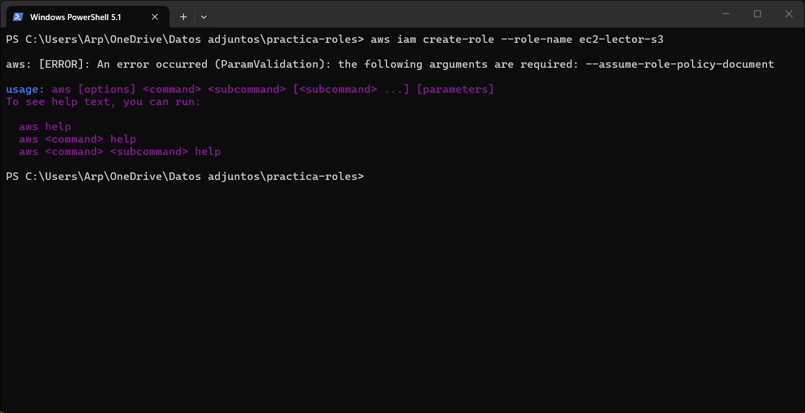
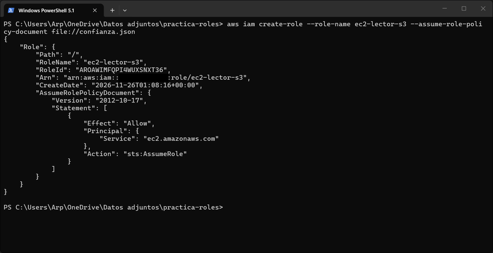
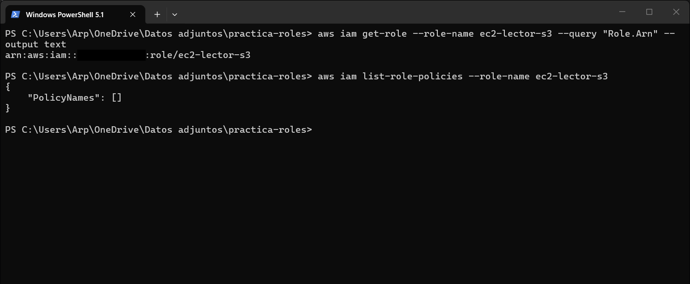
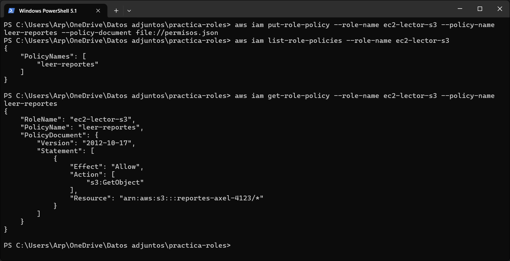
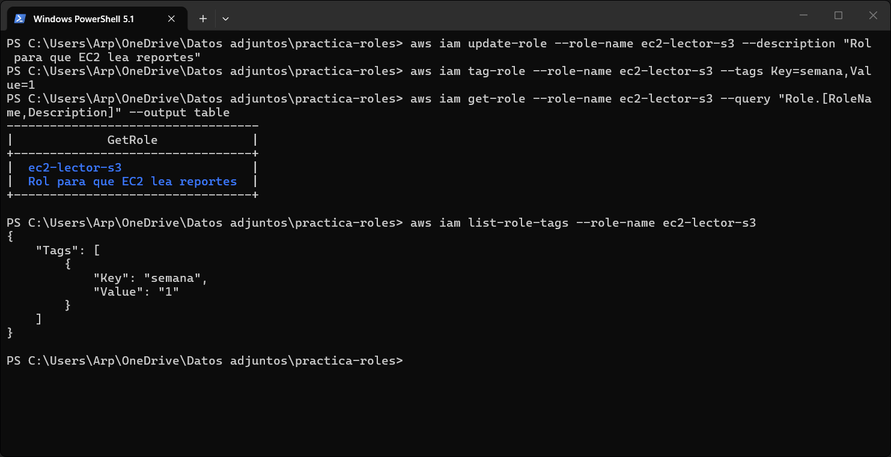
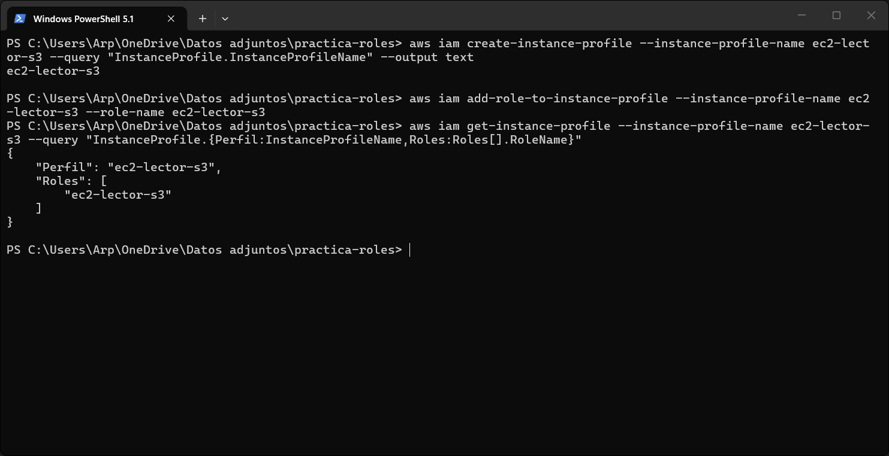
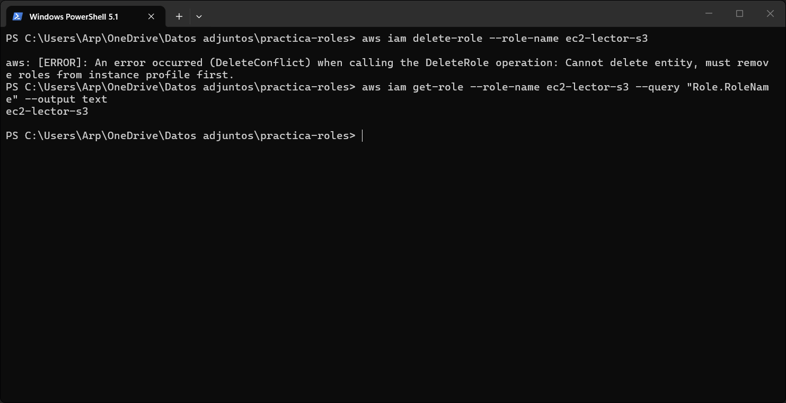

# Actividad 4: un rol para la instancia EC2

Crear un rol de IAM con menor privilegio y dejarlo dentro de un perfil de instancia, listo para la práctica de EC2 (guía `03-activity-roles.md`, semana 1).

- **Usuario administrador:** `axel-admin`
- **Bucket:** `reportes-axel-4123`, con `reporte.txt` y guardado en la variable de PowerShell `$B`
- **Rol y perfil de instancia:** `ec2-lector-s3`
- **Política en línea:** `leer-reportes`
- **Región:** `us-east-2`

> El número de cuenta está tapado en las capturas. El rol no tiene llaves: sus credenciales son temporales y no se guardan en ningún archivo.

## Parte 1: el recurso a proteger (pasos 1 a 3)

```powershell
$B = "reportes-axel-4123"
aws s3 mb s3://$B
Set-Content reporte.txt "Reporte semanal: ventas 120, devoluciones 3"
aws s3 cp reporte.txt s3://$B/
aws s3 ls s3://$B/
```

El bucket existe y contiene `reporte.txt` (45 bytes). La actividad no pide captura de esta parte.

## Parte 2: las dos políticas (pasos 4 a 6)

**`confianza.json`: quién puede asumir el rol.** Solo el servicio EC2.

```json
{
  "Version": "2012-10-17",
  "Statement": [{
    "Effect": "Allow",
    "Principal": { "Service": "ec2.amazonaws.com" },
    "Action": "sts:AssumeRole"
  }]
}
```

**`permisos.json`: qué puede hacer el rol.** Solo leer objetos del bucket.

```json
{
  "Version": "2012-10-17",
  "Statement": [{
    "Effect": "Allow",
    "Action": ["s3:GetObject"],
    "Resource": "arn:aws:s3:::reportes-axel-4123/*"
  }]
}
```

Los dos se validaron con `python -m json.tool`. En Windows el comando es `python` y no `python3`.

## Parte 3: crear el rol (pasos 7 a 10)

**Paso 7: crear el rol sin política de confianza.** La CLI lo rechaza antes de llegar a AWS (`ParamValidation`): un rol no puede existir sin indicar quién puede asumirlo.

```powershell
aws iam create-role --role-name ec2-lector-s3
```



**Paso 8: crearlo con `confianza.json`**

```powershell
aws iam create-role --role-name ec2-lector-s3 --assume-role-policy-document file://confianza.json
```



**Pasos 9 y 10: su `Arn` y sus políticas en línea.** El `Arn` es `arn:aws:iam::<cuenta>:role/ec2-lector-s3`. La lista de políticas está vacía: el rol todavía no tiene ningún permiso.

```powershell
aws iam get-role --role-name ec2-lector-s3 --query "Role.Arn" --output text
aws iam list-role-policies --role-name ec2-lector-s3
```



## Parte 4: dar permisos (pasos 11 a 13)

`put-role-policy` no devuelve nada cuando funciona. Después, la política aparece en la lista y AWS muestra una sola acción, `s3:GetObject`, sobre el bucket.

```powershell
aws iam put-role-policy --role-name ec2-lector-s3 --policy-name leer-reportes --policy-document file://permisos.json
aws iam list-role-policies --role-name ec2-lector-s3
aws iam get-role-policy --role-name ec2-lector-s3 --policy-name leer-reportes
```



## Parte 5: editar (pasos 14 a 16)

```powershell
aws iam update-role --role-name ec2-lector-s3 --description "Rol para que EC2 lea reportes"
aws iam tag-role --role-name ec2-lector-s3 --tags Key=semana,Value=1
aws iam get-role --role-name ec2-lector-s3 --query "Role.[RoleName,Description]" --output table
aws iam list-role-tags --role-name ec2-lector-s3
```



## Parte 6: perfil de instancia (pasos 17 a 19)

Con la CLI, el perfil de instancia hay que crearlo a mano; la consola web lo crea sola.

```powershell
aws iam create-instance-profile --instance-profile-name ec2-lector-s3
aws iam add-role-to-instance-profile --instance-profile-name ec2-lector-s3 --role-name ec2-lector-s3
aws iam get-instance-profile --instance-profile-name ec2-lector-s3
```



## Parte 7: comprobar las reglas de IAM (paso 20)

IAM no deja borrar un rol que todavía está dentro de un perfil de instancia. El comando falla con `DeleteConflict` y `get-role` confirma que el rol sigue existiendo.

```powershell
aws iam delete-role --role-name ec2-lector-s3
aws iam get-role --role-name ec2-lector-s3 --query "Role.RoleName" --output text
```



## Recursos que quedan para la actividad 5

| Recurso | Nombre |
|---|---|
| Bucket | `reportes-axel-4123` con `reporte.txt` |
| Rol | `ec2-lector-s3` |
| Perfil de instancia | `ec2-lector-s3` |

Se borrarán al terminar la práctica de EC2, en este orden: sacar el rol del perfil y borrar el perfil, borrar la política en línea, borrar el rol y vaciar y borrar el bucket.

---

## Preguntas de reflexión

1. ¿Qué diferencia hay entre la política de confianza y la política de permisos? ¿Qué pasaría si el rol tuviera solo una de las dos?

   La de confianza dice quién puede ponerse el rol y la de permisos dice qué puede hacer con él. Si solo tuviera la de confianza, la instancia podría asumir el rol pero no podría hacer nada, debido a que todo está negado por defecto. Si solo tuviera la de permisos, ni siquiera se podría crear, como se vio en el paso 7.

2. ¿Por qué es más seguro que la instancia use un rol en vez de guardar una llave de acceso con `aws configure`?

   Debido a que con el rol no queda ninguna llave guardada en la instancia. Las credenciales son temporales y AWS las renueva solo, así que si alguien entra al servidor y las roba, dejan de servir en pocas horas. Una llave guardada con `aws configure` sirve hasta que alguien la borre.

3. Con la política `leer-reportes`, ¿la instancia podrá listar el contenido del bucket? ¿Y borrar `reporte.txt`? Explica por qué.

   No podrá listar el bucket, debido a que eso necesita `s3:ListBucket` y la política solo tiene `s3:GetObject`. Tampoco podrá borrar `reporte.txt`, porque le falta `s3:DeleteObject`. Solo puede leer un archivo si sabe su nombre.

4. En el error del paso 20, ¿qué le falta por hacer antes de poder borrar el rol?

   Le falta sacar el rol del perfil de instancia con `remove-role-from-instance-profile`, y después borrar la política en línea `leer-reportes`. Recién ahí se puede borrar el rol.

5. Si mañana la instancia también necesita subir archivos al bucket, ¿qué cambiarías y en cuál de los dos archivos?

   Cambiaría `permisos.json`, agregando la acción `s3:PutObject` junto a `s3:GetObject`, y lo volvería a aplicar con `put-role-policy`. La de confianza no se toca, debido a que quien usa el rol sigue siendo EC2.
