# Actividad 5: tu primer servidor en EC2

Lanzar una instancia EC2 con un servidor web, protegerla con un security group y comprobar que usa el rol de IAM de la actividad 4 para leer un bucket sin tener llaves guardadas (guía `03-activity-ec2.md`, semana 1).

- **Usuario administrador:** `axel-admin`
- **Instancia:** `web-axel`, `t3.micro` con Amazon Linux 2023 (`ami-01e4a7224fcbfe81f`)
- **Par de llaves:** `clave-axel`
- **Security group:** `web-axel`
- **Perfil de instancia:** `ec2-lector-s3`, de la actividad 4
- **Bucket:** `reportes-axel-4123`, guardado en la variable de PowerShell `$B`
- **Región:** `us-east-2`

> El número de cuenta y mi IP de casa están tapados en las capturas. El archivo `.pem` nunca estuvo en el repositorio y ya fue borrado. La instancia, el security group, la llave, el rol y el bucket fueron eliminados al terminar.

## Parte 1: reconocer el terreno (pasos 1 a 4)

```powershell
aws sts get-caller-identity
aws configure get region
aws iam get-instance-profile --instance-profile-name ec2-lector-s3
aws ssm get-parameters --names /aws/service/ami-amazon-linux-latest/al2023-ami-kernel-default-x86_64 --query "Parameters[0].Value" --output text
aws ec2 describe-vpcs --filters Name=isDefault,Values=true --query "Vpcs[].VpcId" --output text
```

Trabajo como `axel-admin` en `us-east-2`, el perfil `ec2-lector-s3` tiene el rol dentro, la AMI es `ami-01e4a7224fcbfe81f` y la VPC por defecto es `vpc-06ee3807a7067d4b4`. La actividad no pide captura de esta parte.

## Parte 2: par de llaves (pasos 5 a 7)

En Windows hay dos cambios respecto a la guía:

- **La llave se guarda en ASCII.** En PowerShell 5.1, el `>` guarda el archivo en UTF-16 y SSH no lo entiende, así que se usa `Out-File -Encoding ascii`.
- **`icacls` reemplaza a `chmod 400`.** Quita los permisos heredados y deja solo lectura para mi usuario. SSH rechaza las llaves que otros pueden leer.

```powershell
aws ec2 create-key-pair --key-name clave-axel --query "KeyMaterial" --output text | Out-File -Encoding ascii clave-axel.pem
icacls clave-axel.pem /inheritance:r /grant:r "$($env:USERNAME):R"
aws ec2 describe-key-pairs --query "KeyPairs[].KeyName" --output table
```

## Parte 3: security group (pasos 8 a 12)

```powershell
$SG = aws ec2 create-security-group --group-name web-axel --description "HTTP abierto y SSH solo desde mi IP" --query "GroupId" --output text
curl.exe -s https://checkip.amazonaws.com
aws ec2 authorize-security-group-ingress --group-id $SG --protocol tcp --port 80 --cidr 0.0.0.0/0
aws ec2 authorize-security-group-ingress --group-id $SG --protocol tcp --port 22 --cidr <mi-ip>/32
```

**Paso 12: las reglas.** Son dos: el 80 abierto a todo internet y el 22 solo para mi IP.

```powershell
aws ec2 describe-security-groups --group-ids $SG --query "SecurityGroups[].IpPermissions[].[FromPort,IpRanges[0].CidrIp]" --output table
```

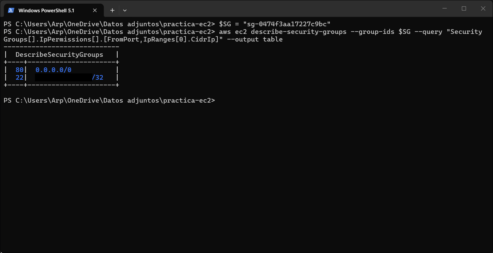

> Mi IP pública cambió durante la práctica y SSH empezó a dar `Connection timed out`. Lo resolví quitando la regla vieja con `revoke-security-group-ingress` y abriendo el 22 a la IP nueva, otra vez con `/32`. El 22 nunca estuvo abierto a `0.0.0.0/0`.

## Parte 4: lanzar la instancia (pasos 13 a 16)

**`inicio.sh`, el script de arranque (user data).** Tiene que quedar con saltos de línea de Linux (LF). Con los de Windows (CRLF), la primera línea sería `#!/bin/bash\r` y el script no correría. Por eso no se escribe con Notepad ni con `Set-Content`, que usan CRLF.

```bash
#!/bin/bash
dnf install -y httpd
systemctl enable --now httpd
echo "<h1>Hola, soy Axel: este es mi primer servidor en EC2</h1>" > /var/www/html/index.html
```

```powershell
aws ec2 run-instances --image-id ami-01e4a7224fcbfe81f --instance-type t3.micro --key-name clave-axel --security-group-ids $SG --iam-instance-profile Name=ec2-lector-s3 --user-data file://inicio.sh --tag-specifications "ResourceType=instance,Tags=[{Key=Name,Value=web-axel}]" --query "Instances[0].InstanceId" --output text
aws ec2 wait instance-running --instance-ids $ID
```

**Paso 16: la IP pública.** La instancia `i-03ca53403724f3137` está `running`, tiene la IP `18.119.101.107` y el perfil `ec2-lector-s3`.

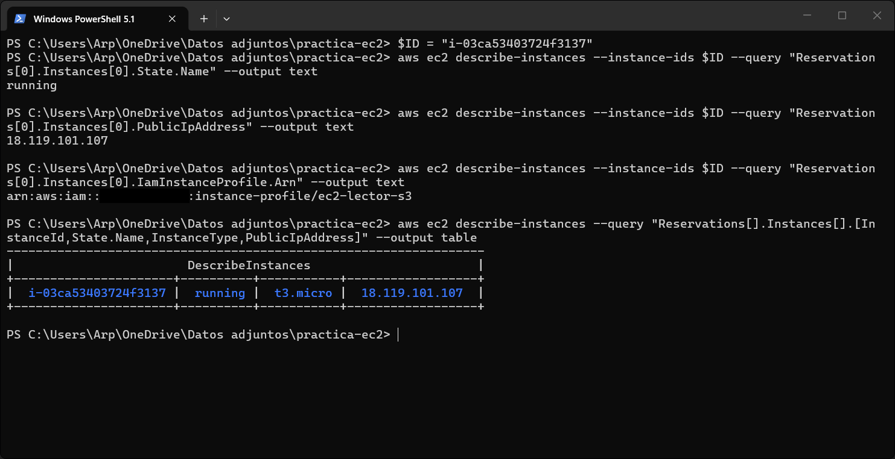

## Parte 5: probar el servidor web (pasos 17 y 18)

**Paso 17: la página en el navegador.** Brave y Edge muestran primero el aviso "Este sitio no admite una conexión segura", porque el servidor usa `http` sin certificado. La captura es de Edge en modo headless, que abre `http://18.119.101.107` sin ese aviso.

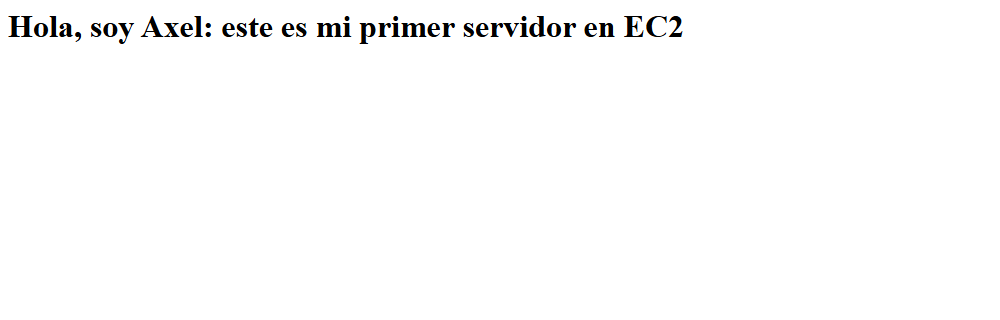

**Paso 18: la misma petición con `curl.exe`**

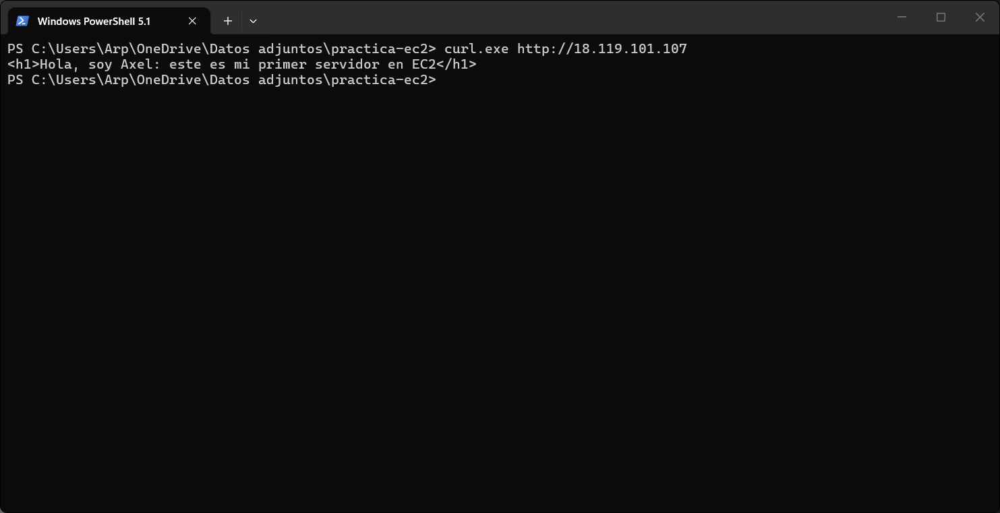

## Parte 6: entrar y probar el rol (pasos 19 a 24)

Cada comando se manda por SSH entre comillas: se ejecuta dentro de la instancia y la salida vuelve a mi terminal. `$EC2` vale `ec2-user@18.119.101.107`.

**Paso 20: la identidad.** La instancia responde con el rol `ec2-lector-s3` (`assumed-role`) y no con mi usuario. `aws configure list` muestra de dónde vienen las credenciales: `iam-role`, y la región `imds`, el servicio de metadatos de la instancia. No existe `~/.aws/credentials`: nunca corrí `aws configure` dentro de la instancia.

```powershell
ssh -i clave-axel.pem $EC2 "aws sts get-caller-identity"
ssh -i clave-axel.pem $EC2 "aws configure list; ls ~/.aws/credentials"
```

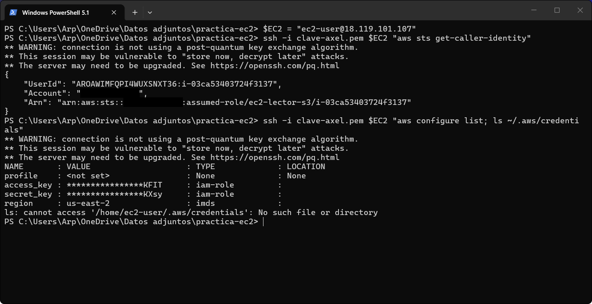

**Paso 21: leer `reporte.txt`.** Funciona: el rol tiene `s3:GetObject`.

```powershell
ssh -i clave-axel.pem $EC2 "aws s3 cp s3://$B/reporte.txt -"
```

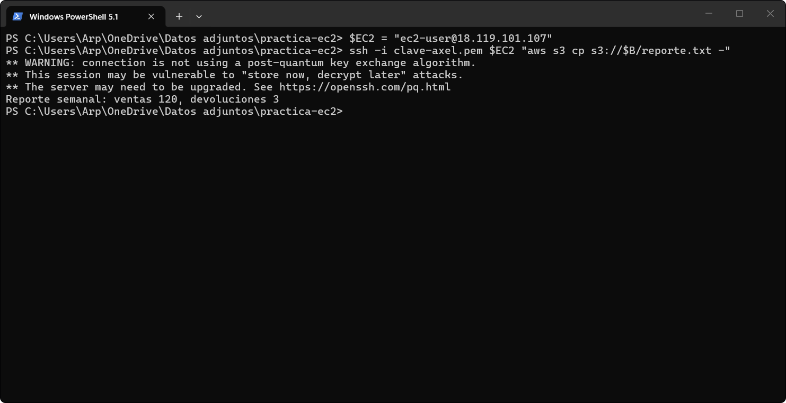

**Pasos 22 y 23: listar el bucket y los usuarios de IAM.** Los dos dan `AccessDenied`, porque la política `leer-reportes` no incluye `s3:ListBucket` ni `iam:ListUsers`.

```powershell
ssh -i clave-axel.pem $EC2 "aws s3 ls s3://$B/"
ssh -i clave-axel.pem $EC2 "aws iam list-users"
```

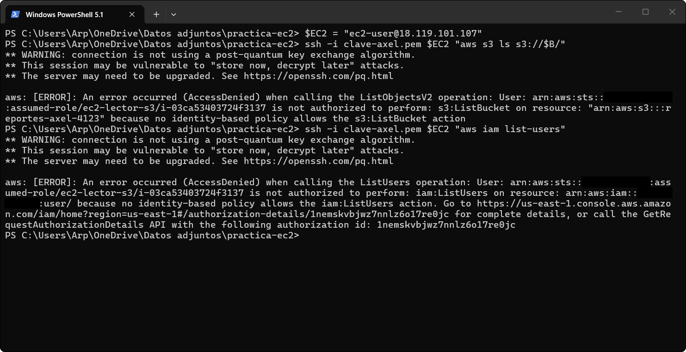

## Parte 7: estados de la instancia (pasos 25 a 27)

**Paso 25: apagar.** Pasa de `running` a `stopping` y luego a `stopped`. Apagada no tiene IP pública (`None`).

```powershell
aws ec2 stop-instances --instance-ids $ID
aws ec2 wait instance-stopped --instance-ids $ID
```

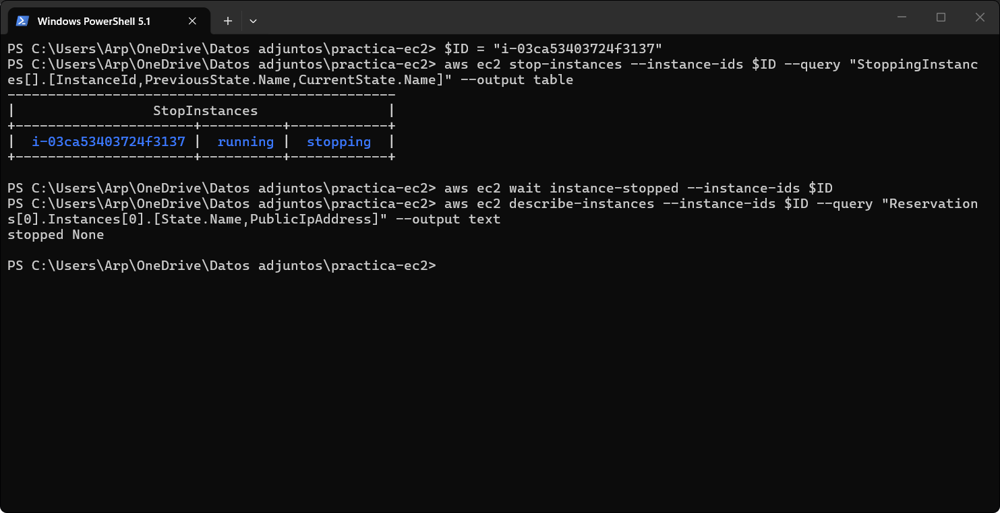

**Pasos 26 y 27: encender y comparar la IP.** Antes era `18.119.101.107` y ahora es `18.117.85.72`: la IP pública cambió.

```powershell
aws ec2 start-instances --instance-ids $ID
aws ec2 wait instance-running --instance-ids $ID
```

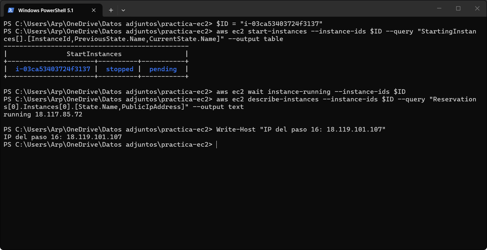

## Parte 8: eliminar (pasos 28 a 32)

**Reto y pasos 28 y 29.** Justo después de `terminate-instances`, con la instancia todavía en `shutting-down`, intenté borrar el security group. Falló con `DependencyViolation ... has a dependent object`, porque la instancia todavía lo usaba. Cuando quedó `terminated`, se borró sin problema.

```powershell
aws ec2 terminate-instances --instance-ids $ID
aws ec2 delete-security-group --group-id $SG
aws ec2 wait instance-terminated --instance-ids $ID
aws ec2 delete-security-group --group-id $SG
```

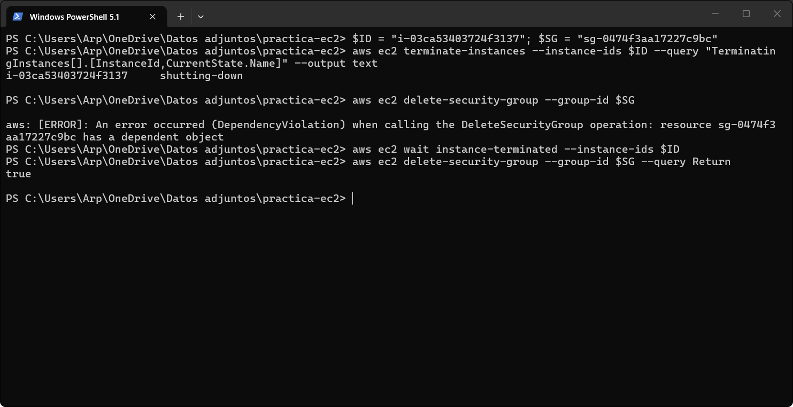

**Pasos 30 y 31: la llave y la lista de instancias.** La llave se borró en AWS con `delete-key-pair`. Para borrar el `.pem` hubo que devolverle a mi usuario el control total con `icacls`, porque el permiso de solo lectura no deja borrarlo. Ya no hay pares de llaves, solo queda el security group `default` de la VPC, y la única instancia está `terminated`, ni `running` ni `stopped`.

```powershell
aws ec2 delete-key-pair --key-name clave-axel
icacls clave-axel.pem /grant:r "$($env:USERNAME):F"
Remove-Item clave-axel.pem
aws ec2 describe-instances --query "Reservations[].Instances[].[InstanceId,State.Name,InstanceType,PublicIpAddress]" --output table
```

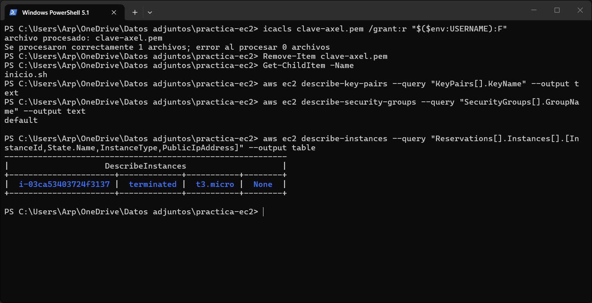

**Paso 32: limpieza de la actividad 4**, en el orden que exige IAM: sacar el rol del perfil, borrar el perfil, borrar la política en línea, borrar el rol y vaciar y borrar el bucket.

```powershell
aws iam remove-role-from-instance-profile --instance-profile-name ec2-lector-s3 --role-name ec2-lector-s3
aws iam delete-instance-profile --instance-profile-name ec2-lector-s3
aws iam delete-role-policy --role-name ec2-lector-s3 --policy-name leer-reportes
aws iam delete-role --role-name ec2-lector-s3
aws s3 rb s3://$B --force
```

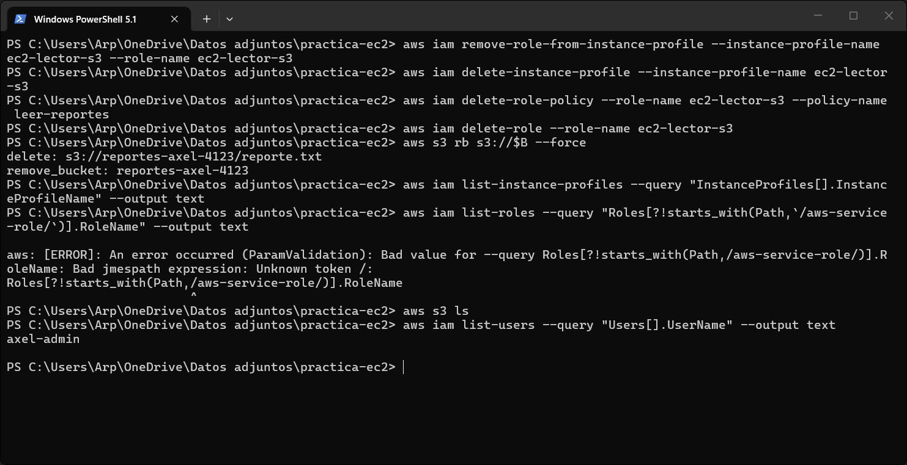

**Comprobación final.** En la cuenta solo queda `axel-admin`. No hay roles propios (los que quedan son de AWS, con rutas `/managed/` y `/aws-service-role/`), ni perfiles de instancia, buckets, pares de llaves o instancias encendidas o apagadas.

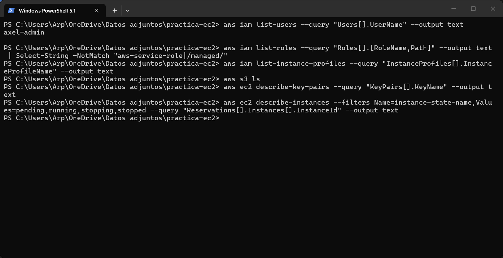

---

## Preguntas de reflexión

1. En el paso 20, la instancia responde con un rol y no con un usuario. ¿De dónde sacó esas credenciales si nunca corriste `aws configure`?

   Del perfil de instancia. Al lanzarla le di `ec2-lector-s3`, y EC2 le entrega a la instancia credenciales temporales de ese rol mediante el servicio de metadatos (IMDS). La CLI las busca ahí sola cuando no encuentra llaves en `~/.aws`, por eso `aws configure list` dice `iam-role`. AWS las renueva antes de que caduquen.

2. ¿Por qué el puerto 80 puede estar abierto a todo internet y el 22 no?

   Debido a que el 80 es la página web, que está hecha para que cualquiera la vea y solo deja leerla. El 22 es SSH, la puerta para entrar a manejar el servidor. Si estuviera abierto a todos, cualquiera en internet podría intentar entrar probando llaves o aprovechando un fallo de SSH, así que solo lo abro para mi IP.

3. La instancia pudo leer `reporte.txt` pero no listar el bucket. ¿Dónde se decidió eso?

   En la política en línea `leer-reportes` del rol, que solo tiene `s3:GetObject` sobre `reportes-axel-4123/*`. Listar necesita `s3:ListBucket` sobre el bucket, y como no está permitido, se niega por defecto. La instancia no decide nada: IAM revisa la política en cada petición.

4. ¿Por qué cambió la IP pública al apagar y encender? ¿Qué problema traería eso en un sitio web real?

   Debido a que la IP pública no es de la instancia: AWS se la presta mientras está encendida y la devuelve al apagarla. Al encender le da otra. En un sitio real, el dominio seguiría apuntando a la IP vieja y la página dejaría de cargar hasta cambiar el DNS. Para evitarlo se usa una IP elástica o un balanceador de carga delante.

5. EC2 es infraestructura como servicio (IaaS). En esta práctica, ¿qué fue responsabilidad tuya y qué fue responsabilidad de AWS?

   Mía: elegir la AMI y el tamaño, configurar el security group, cuidar el `.pem`, instalar httpd y la página, darle a la instancia solo los permisos necesarios y borrarlo todo al final. También las actualizaciones del sistema operativo. De AWS: el hardware, el edificio, la energía, la red física y la virtualización, y reemplazar el equipo si se daña.

6. Para tener este mismo servidor en una oficina, sin la nube, ¿qué habrías tenido que comprar y configurar?

   Un servidor físico con su disco, un rack o espacio donde ponerlo, una UPS para los cortes de luz, aire acondicionado, un router y un firewall, y contratar internet con IP pública fija. Además, instalar el sistema operativo desde cero, configurar la red y el firewall, y encargarme de repararlo si falla. Todo eso tarda semanas y se paga por adelantado, aunque el servidor se use una hora.
